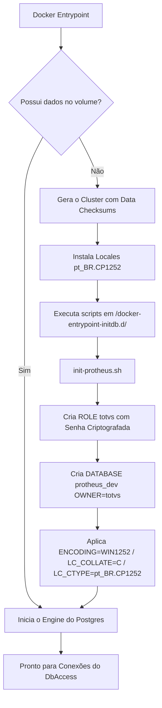

# docker-postgres-protheus

Este repositório encapsula a infraestrutura oficial do banco de dados **PostgreSQL** customizado para o ecossistema **TOTVS Protheus**. Ele estende a imagem oficial para embutir as dependências do sistema operacional (*locales* e codificação de caracteres) e automatizar o provisionamento seguro da base de dados e do usuário corporativo.

> **Nome da imagem**: publicada como `rodrigomicrosiga/postgres-dev` (sem o sufixo `-protheus-`) porque, apesar de o repositório e as automações serem voltadas ao Protheus, a imagem em si não tem nenhuma dependência exclusiva dele — um dev pode optar por usá-la também com o TOTVS Smartview, por exemplo. O nome antigo `postgres-protheus-dev` fica descontinuado (imagens antigas continuam publicadas lá, mas sem novos builds).

## 🏗️ Arquitetura de Inicialização

O diagrama abaixo ilustra como o container trata as variáveis de ambiente no primeiro boot e injeta os padrões rígidos de banco exigidos pela TOTVS (`WIN1252` e `pt_BR.CP1252`):



### 📋 Pré-requisitos e Variáveis

Crie um arquivo `.env.postgres` na raiz da sua execução (seja via `Docker Compose` ou `Kubernetes Secrets`) baseando-se no modelo abaixo:

```env
DB_TYPE=POSTGRES
DB_SERVER=protheus_postgres
DB_PORT=5432

# --- DBACCESS AUTOMATION TARGETS (Acesso da Aplicação) ------------------------
DB_USER=totvs
DB_PASS=totvs
DB_NAME=protheus_dev

# --- POSTGRES ENGINE CONFIGURATION (ROOT SUPERUSER) ---------------------------
POSTGRES_ROOT_USER=postgres
POSTGRES_ROOT_PASSWORD=root_postgres_secure_password
POSTGRES_PORT=5432
```

### 🏷️ Rastreabilidade de Build

A tag da imagem publicada permanece fixa (`16`) entre builds — o versionamento aqui segue a major version do Postgres, não o commit. Para rastrear qual commit gerou um build específico sem depender da tag, o `pipeline` grava o label `org.opencontainers.image.revision` com o SHA do commit em toda imagem publicada:

```bash
docker inspect --format '{{ index .Config.Labels "org.opencontainers.image.revision" }}' rodrigomicrosiga/postgres-dev:16
```

### 🚀 Como Executar Localmente (Apenas para Testes)

```bash
docker run -d \
  --name postgres-protheus \
  -p 5432:5432 \
  --env-file .env \
  rodrigomicrosiga/postgres-dev:16
```
